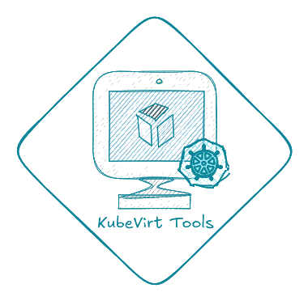

<p align="center">
  
</p>

# KubeVirt Tools

Phoenix web app for **cluster-wide KubeVirt and Kubernetes visibility**: sign in with a kubeconfig, then explore a LiveView dashboard that auto-refreshes every 30 seconds (plus a manual refresh button).

## What you get

- **Dashboard** — VM / VMI counts, node capacity charts, PVC breakdowns, optional **Prometheus** overlays for cluster usage and node CPU/memory when metrics-server is missing. Auto-refreshes every 30s.
- **VMs** — VirtualMachine list with VMI join, orphan VMI section, real CPU/RAM usage (used/total, refreshed every 30s) via metrics-server on the virt-launcher pod, and a color-coded QEMU guest agent indicator. Filter by Phase, Node, or Agent. Click a row for a full detail page, including CPU/memory history charts (last 30 min — **requires Prometheus**, see below).
- **Networks** — Template interfaces vs live VMI network data. Filter by Binding or VMI phase. Click a row for full interface detail.
- **Disks** — Volume and PVC-backed disk detail. Filter by Volume kind, Storage class, or PVC phase. Click a row for full disk detail.
- **Storage classes** — `StorageClass` inventory with provisioner, reclaim policy, binding mode, expansion, parameters, and PVC counts (plus warnings for mismatched PVC references). Filter by Provisioner. Click a row for full detail, including every PVC using that class.
- **Nodes** — Kubernetes Nodes with scheduling, metrics, and VMI counts. Filter by Ready or Role. Click a row for full detail, including every VM scheduled on that node.
- **Topology** — Interactive node ↔ VM graph (vis-network).
- **Export** — CSV / XLSX downloads of VM inventory.
- **Metrics** — App exposes **`GET /metrics`** in Prometheus text format for scraping.

## Based on / inspired by

Ideas and goals here overlap with tools that help operators **see, export, and reason about** virtual infrastructure:

- **[RVTools](https://www.dell.com/en-us/shop/vmware/sl/rvtools)** — the well-known VMware vSphere inventory and reporting workflow (spreadsheet-friendly exports, environment-wide visibility).
- **[OVTools](https://github.com/linuxelitebr/ovtools-release)** (OpenShift Virtualization Tools) — RVTools-style consolidated inventory and reporting for **OpenShift Virtualization** / Kubernetes-native VMs across namespaces, rather than stitching together `kubectl` / YAML by hand.
- **[KubeVirt Manager](https://github.com/kubevirt-manager/kubevirt-manager)** — a web UI focused on operating KubeVirt day to day (VMs, storage, monitoring, and related resources).

KubeVirt Tools is not affiliated with those projects; it is an independent Phoenix app aimed at similar **cluster-wide clarity** on plain KubeVirt clusters.

## Requirements

**To deploy on Kubernetes/OpenShift** (the intended way to run this — see **Quick start** below): just `kubectl` or `oc` pointed at your cluster. The image is prebuilt; no Elixir, Erlang, or `mix` needed.

**To run locally for development** (hacking on the app itself):

- Elixir & Erlang installed.
- `mix` command available in $PATH
- A cluster reachable with the uploaded kubeconfig (KubeVirt CRDs where applicable)

## Quick start

### Run locally (development)

```bash
git clone https://github.com/z7ealth/kubevirt_tools.git
cd kubevirt_tools
mix setup
mix phx.server
```

Open [http://localhost:4000](http://localhost:4000) and upload a valid kubeconfig.

### Deploy on Kubernetes / OpenShift

1. **Clone the repository** and enter the directory:

   ```bash
   git clone https://github.com/z7ealth/kubevirt_tools
   cd kubevirt_tools
   ```

2. **(Optional) configure secrets** — edit `deploy/k8s/secret.yaml` and set `PHX_HOST` if you don't want the default `localhost`. `SECRET_KEY_BASE` and `PROMETHEUS_URL` can both be left unset — the app falls back to a randomly generated key and to `http://localhost:9090` respectively (see **Configuration** below).

3. **Run the install script** (from the repo root):

   ```bash
   ./deploy/k8s/install.sh
   ```

   It creates the `kubevirt-tools` namespace if needed, applies all the manifests, and waits for the rollout to finish. Works with either `kubectl` or `oc` (auto-detected), and accepts `-n NAMESPACE` to install elsewhere. On a detected OpenShift cluster it also automatically applies `route.yaml` and grants read access to OpenShift's built-in cluster-monitoring Prometheus (see **Kubernetes vs OpenShift** below); use `--openshift` / `--kubernetes` to force that detection, or `--no-openshift-monitoring` to skip just the monitoring grant. On OpenShift it also adds **KubeVirt Tools to the web console's application launcher** (the grid icon in the top bar, under *OpenShift Virtualization*) via a `ConsoleLink` pointing at the Route (`deploy/k8s/console_link.yaml.tmpl`; needs cluster-admin, skip with `--no-console-link`). Safe to re-run.

   To remove everything again:

   ```bash
   ./deploy/k8s/uninstall.sh
   ```

   This leaves the namespace itself in place (in case it's shared); pass `--purge-namespace` to delete it too.

   **Upgrading an existing install:** if you installed before per-VM CPU/RAM usage was added, re-run `./deploy/k8s/install.sh` (or `kubectl apply -f deploy/k8s/cluster_role.yaml`) to pick up the added `pods` / `metrics.k8s.io pods` RBAC — no other manifest needs to change.

   Prefer to apply the manifests yourself? `kubectl apply -f deploy/k8s/` (or `oc apply -f deploy/k8s/`) works too — just note that **`deploy/k8s/route.yaml` is OpenShift-only** (`route.openshift.io`) and will fail on a plain Kubernetes cluster; skip that file and expose the app with an **Ingress** (or another controller) targeting the `kubevirt-tools-service` Service yourself. You'll also need to create the namespace first (`kubectl create namespace kubevirt-tools`, or `oc new-project kubevirt-tools`) since it isn't included as a manifest.

### Quick expose (port-forward)

Without a Route or Ingress, you can reach the app by forwarding the Service port (Service port **80** maps to the container’s **4000**):

```bash
kubectl port-forward -n kubevirt-tools svc/kubevirt-tools-service 4000:80
```

With the OpenShift CLI: `oc port-forward -n kubevirt-tools svc/kubevirt-tools-service 4000:80`.

Then open [http://localhost:4000](http://localhost:4000). Leave the command running while you use the UI.

### Signing in

When deployed with `deploy/k8s/install.sh` (or the manifests directly), the app auto-detects its own mounted `kubevirt-tools-sa` service account and signs you straight into the dashboard — no kubeconfig upload needed. This works regardless of which namespace you installed into (`install.sh -n NAMESPACE`); only the service account **name** has to match, not the namespace.

If that service account isn't found or usable (running outside a cluster, RBAC not applied, a different service account name, etc.), the app falls back silently to the kubeconfig upload form — no error is shown, you just sign in with an uploaded kubeconfig instead.

## Testing

This app has been tested on both a plain KubeVirt cluster and OpenShift Virtualization (CNV), including an on-prem OpenShift install. See **Kubernetes vs OpenShift** below for the handful of things that differ between the two.

## Kubernetes vs OpenShift

Everything in this app works the same on both — this table is just the handful of places behavior or setup actually differs. If you're not sure which of these apply to you, none of them are needed on a plain Kubernetes/KubeVirt cluster; read down the OpenShift column only if that's what you're running.

| | Plain Kubernetes / KubeVirt | OpenShift / OpenShift Virtualization |
|---|---|---|
| **Exposing the app** | No Route object; use an **Ingress** (not included, add your own) or `kubectl port-forward` | `install.sh` applies `deploy/k8s/route.yaml` automatically |
| **In-cluster sign-in TLS** | Usually just works | On-prem / self-signed-CA clusters often need `KUBERNETES_INSECURE_SKIP_TLS_VERIFY=true` — otherwise sign-in silently falls back to the manual kubeconfig upload screen (see **Signing in**) |
| **VM CPU/memory history charts** | Deploy your own Prometheus; no extra RBAC or TLS config needed | Can reuse the built-in cluster-monitoring Prometheus instead — `install.sh` grants the required `cluster-monitoring-view` RBAC automatically, but you still need to set `PROMETHEUS_URL` to it and `PROMETHEUS_INSECURE_SKIP_TLS_VERIFY=true` yourself (its certificate is signed by OpenShift's internal `service-ca`) — see **VM CPU/memory history charts** below |
| **KubeVirt version display** | Shows a normal version string (e.g. `v1.x.x`) | Shows a shortened image digest (e.g. `sha256:abc123…`, full value on hover) — that's genuinely what OpenShift Virtualization's `KubeVirt` CR reports, not a display bug |

## Work in progress (WIP)

**Kubernetes deployment** — Sample manifests live under `deploy/k8s/` (Deployment, Service, RBAC, Secret template). A generic **Ingress** manifest is not included; use the **Route** only on OpenShift (see **Deploy on Kubernetes / OpenShift** above).

## Build

To produce a **production OTP release** (self-contained under `_build/prod/rel/kubevirt_tools/`), from the repository root:

```bash
MIX_ENV=prod mix deps.get --only prod
MIX_ENV=prod mix assets.deploy
MIX_ENV=prod mix release --overwrite
```

Omit `--overwrite` on the first build; use it when rebuilding so `mix release` does not stop at an interactive prompt.

Set runtime environment variables as in **Configuration**. Start the release with the HTTP server enabled:

```bash
cd _build/prod/rel/kubevirt_tools
export PHX_HOST=example.com  # public hostname for URL generation
export PORT=4000
PHX_SERVER=true bin/kubevirt_tools start
```

`SECRET_KEY_BASE` is optional — if unset, a random value is generated at boot (sessions won't survive a restart). Set `export SECRET_KEY_BASE="…"` (e.g. output of `mix phx.gen.secret` or `openssl rand -base64 48`) if you need sessions to persist across restarts.

The release must be built on an OS **compatible with** the machine where you run it (same distribution family / libc expectations as a typical Elixir release). For more context, see the [Phoenix deployment guide](https://hexdocs.pm/phoenix/deployment.html).

---

## Configuration

### Environment variables

| Variable | Required | Default | Purpose |
|----------|----------|---------|---------|
| `PORT` | No | `4000` | HTTP listen port (see `config/runtime.exs`). |
| `PHX_SERVER` | For releases | — | If set (any value), enables the web server (`server: true` on the endpoint). Example: `PHX_SERVER=true bin/kubevirt_tools start`. |
| `SECRET_KEY_BASE` | No | Randomly generated at boot | Secret for signing cookies and tokens. If unset, a random value is generated each time the app starts, so **existing sessions are invalidated on every restart**. Set this (e.g. `mix phx.gen.secret` or `openssl rand -base64 48`) if you need sessions to survive pod restarts. |
| `PHX_HOST` | No (`:prod`) | `example.com` (`localhost` in `deploy/k8s/secret.yaml`) | Hostname end users type into the browser. Must match, or LiveView's WebSocket connection is rejected — see **Setting PHX_HOST** below. |
| `PROMETHEUS_URL` | No | `http://localhost:9090` | Base URL for the Prometheus HTTP API (`/api/v1/query`, `/api/v1/query_range`, `/-/healthy`). Trimmed whitespace; set when Prometheus is not on localhost. Powers the Nodes tab's Prometheus fallback and the **VM CPU/memory history charts** (see below) — everything else in the app works without it. Every request automatically includes the pod's own in-cluster service-account token as a Bearer credential (harmless if the target doesn't require auth) — only point this at a Prometheus you trust. |
| `PROMETHEUS_INSECURE_SKIP_TLS_VERIFY` | No | Unset (verify TLS) | Same idea as `KUBERNETES_INSECURE_SKIP_TLS_VERIFY` below, but for `PROMETHEUS_URL` specifically (separate client, separate cert trust). Needed e.g. for OpenShift's cluster-monitoring Prometheus, which serves a service-ca-signed certificate. |
| `KUBERNETES_INSECURE_SKIP_TLS_VERIFY` | No | Unset (verify TLS) | If set to a truthy value (`true`, `1`, `yes`, `on`, case-insensitive), the app’s Kubernetes clients skip TLS certificate verification for **in-cluster** service-account connections and merge with kubeconfig mode. When unset, kubeconfig uploads still follow each context’s `insecure-skip-tls-verify` flag. Use only when appropriate (e.g. lab clusters with self-signed CAs). |

Timeouts, upload limits, and Prometheus poll intervals are also configurable via env vars — see **Tuning (timeouts, limits, poll intervals)** below.

### Setting PHX_HOST

`PHX_HOST` isn't just cosmetic: Phoenix's default LiveView origin check compares the browser's `Origin` header against this value, so if it doesn't match the hostname in the address bar, the page loads but the dashboard's WebSocket connection is refused (it'll look "stuck"/disconnected). Set it to whatever hostname you actually type into the browser to reach the app:

| How you reach the app | Set `PHX_HOST` to |
|---|---|
| `kubectl`/`oc port-forward` (e.g. a local kind cluster) | `localhost` — this is the default already in `deploy/k8s/secret.yaml`. |
| OpenShift Route | The Route's hostname, e.g. `kubectl -n kubevirt-tools get route kubevirt-tools-route -o jsonpath='{.spec.host}'`. `install.sh` prints this after installing. |
| Ingress | Whatever host you configured on the Ingress rule. |
| NodePort / LoadBalancer Service | The external IP or DNS name pointing at it. |

After changing it, re-apply the secret and restart the pod (`kubectl rollout restart deployment/kubevirt-tools-app -n kubevirt-tools`) so the new value takes effect.

One more gotcha: `config/prod.exs` sets `force_ssl`, which redirects every host **except** `localhost`/`127.0.0.1` to HTTPS, assuming a TLS-terminating proxy in front (Route/Ingress) sets `X-Forwarded-Proto: https`. If you expose the app over plain HTTP on any other hostname (e.g. a bare NodePort with no TLS), that redirect has nowhere to land and requests will fail. Either put a TLS-terminating Ingress/Route in front, or add your hostname to the `exclude: [hosts: [...]]` list in `config/prod.exs`.

### VM CPU/memory history charts (requires Prometheus)

The VM detail page's CPU/memory charts show the last 30 minutes of real usage history, refreshed every 30s. Unlike the used/total values on the VM list (which come from a live metrics-server snapshot), a history *trend* needs somewhere that actually stores past samples — so these two charts specifically require Prometheus, scraping the standard cAdvisor container metrics every Kubernetes cluster with Prometheus already exposes (`container_cpu_usage_seconds_total`, `container_memory_working_set_bytes` — no KubeVirt-specific exporter or ServiceMonitor needed). If Prometheus isn't reachable, or those metrics aren't present, the charts show a "Setup required" overlay instead of failing silently — everything else on the page works regardless.

To enable, you have two options:

- **Your own Prometheus** (works on both Kubernetes and OpenShift) — deploy one (e.g. `kube-prometheus-stack`) so it scrapes kubelet/cAdvisor, then set `PROMETHEUS_URL` to its address. No auth, no extra RBAC needed.
- **OpenShift's built-in cluster-monitoring Prometheus** — point `PROMETHEUS_URL` at `https://prometheus-k8s.openshift-monitoring.svc.cluster.local:9091` (base URL only, no `/api` suffix). See **Kubernetes vs OpenShift** below — it needs both the RBAC `install.sh` already applies automatically on OpenShift, and `PROMETHEUS_INSECURE_SKIP_TLS_VERIFY=true`.

### Tuning (timeouts, limits, poll intervals)

All optional — sensible defaults apply if unset. Every value is read live from the environment (no rebuild needed, just restart the pod after changing the Secret).

| Key | Default | Purpose |
|-----|---------|---------|
| `POLL_INTERVAL_MS` | `60000` | Global refresh interval for Kubernetes-backed data: the dashboard's auto-refresh (all tabs) and the VM show page's full-page + usage-chart refresh. Both UI hints ("Also auto-refreshes every…", chart titles) reflect this value automatically. |
| `KUBECONFIG_MAX_BYTES` | `512000` | Maximum kubeconfig upload size (bytes). Hard ceiling: 8000000 (8MB) — the HTTP body-parser limit is fixed at compile time and can't be raised past that via env var. |
| `KUBECONFIG_CONNECT_TIMEOUT_MS` | `12000` | Timeout for the Kubernetes API reachability check at sign-in. |
| `PROMETHEUS_CLIENT_TIMEOUT_MS` | `5000` | Timeout for each Prometheus HTTP client call. |
| `PROMETHEUS_POLL_INTERVAL_MS` | `60000` | Interval between **full** Prometheus snapshots (PromQL + node metrics) pushed to the dashboard. Independent of `POLL_INTERVAL_MS` — this one is specifically for the Prometheus-backed data path. |
| `PROMETHEUS_HEALTH_INTERVAL_MS` | `60000` | After a successful snapshot, how often to call Prometheus **`/-/healthy`** so the UI drops “Connected” quickly if the server stops responding. |

---

## Changelog

See [CHANGELOG.md](CHANGELOG.md).

## Learn more

- [Phoenix Framework](https://www.phoenixframework.org/)
- [Phoenix guides](https://hexdocs.pm/phoenix/overview.html)
- [KubeVirt](https://kubevirt.io/)

## Known issue: Logo

The logo may appear low-quality or "questionable."

This is a known feature.

No fix is planned.
